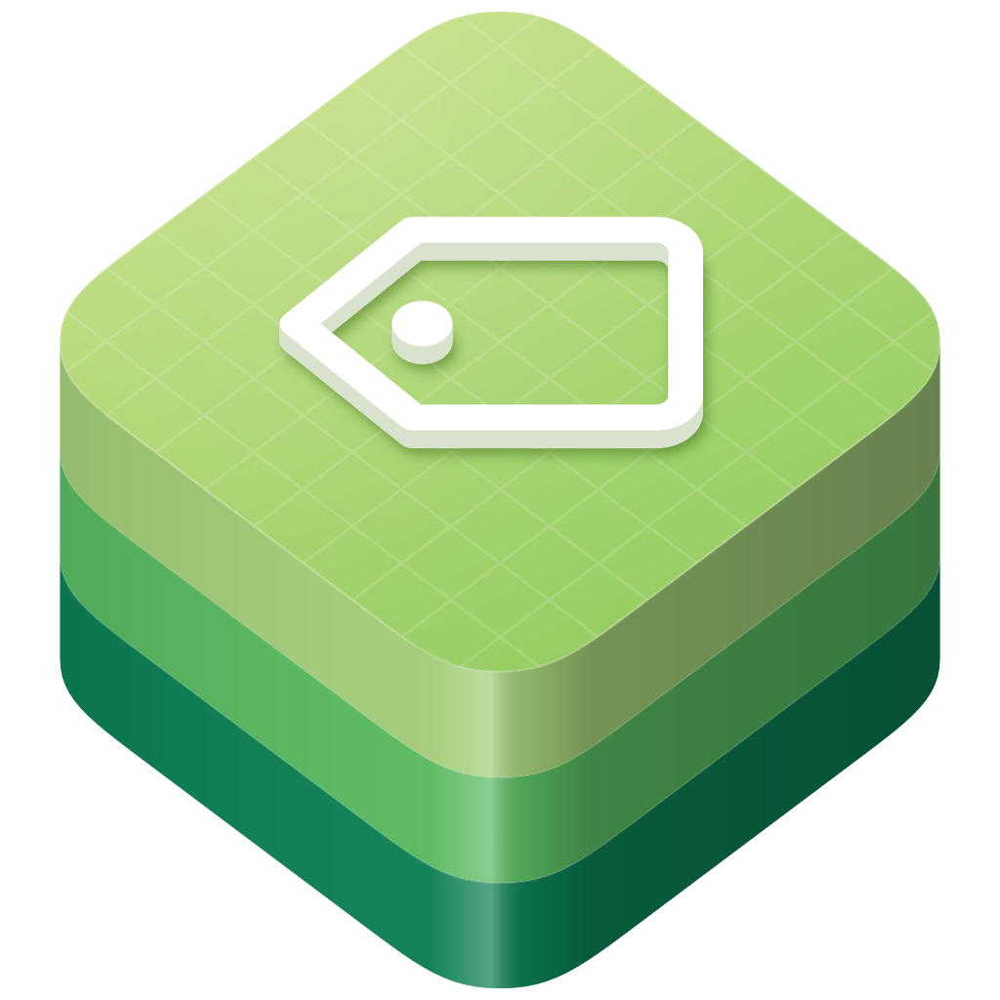

<p align="center">
  <a href="https://github.com/swift-library/swift-semver"></a>
</p>

<h1 align="center" dir="ltr">swift-semver</h1>

<p align="center">
  Parse, compare, constrain, and increment SemVer 2.0.0 versions using only the Swift standard library.
</p>

<p align="center">
  <a href="https://github.com/swift-library/swift-semver/actions/workflows/ci.yml"></a>
  
  
  <a href="LICENSE.txt"></a>
</p>

<p align="center">
  <a href="#overview">Overview</a> ·
  <a href="#quick-look">Quick look</a> ·
  <a href="#install">Install</a> ·
  <a href="#usage">Usage</a> ·
  <a href="#requirements">Requirements</a> ·
  <a href="#documentation">Documentation</a> ·
  <a href="#contributing">Contributing</a> ·
  <a href="#license">License</a>
</p>

## Overview

Parse, compare, constrain, and increment SemVer 2.0.0 versions using only the Swift standard library. `Version` preserves build metadata for display and encoding while comparisons follow SemVer precedence. `VersionRequirement` checks ranges and comparison expressions with explicit prerelease rules; see the [SemVer module documentation](Sources/SemVer/SemVer.docc/SemVer.md).

## Quick look

Parse, compare, constrain, and increment a version:

```swift
import SemVer

let version = try Version(parsing: "1.3.0+build.42")
let requirement = try VersionRequirement(parsing: ">=1.2.0 && <2.0.0")

print(version > Version(1, 2, 0))         // true
print(requirement.contains(version))     // true
print(try version.incrementing(.minor))  // 1.4.0
print(version.description)               // 1.3.0+build.42
```

## Install

Add the package and the `SemVer` product to `Package.swift`:

```swift
dependencies: [
  .package(
    url: "https://github.com/swift-library/swift-semver.git",
    .upToNextMinor(from: "0.1.1")
  ),
],
targets: [
  .target(
    name: "YourTarget",
    dependencies: [
      .product(name: "SemVer", package: "swift-semver"),
    ]
  ),
]
```

> [!NOTE]
> swift-semver is pre-1.0. Minor releases may include source-breaking
> changes, so depend on it with `.upToNextMinor(from:)`.

## Usage

Choose the failable or throwing parser, compare values by SemVer precedence,
and construct requirements from expressions or Swift ranges. Build metadata
survives display and encoding while equality and ordering ignore it.

The [usage guide](Documentation/Reference/Usage.md) covers parser errors,
prerelease matching, range construction, encoding, and checked increments.

## Requirements

- Swift 6.0 or later
- iOS 15 or later, macOS 12 or later, and Linux

The system support window currently covers iOS 18, 26, and 27, and macOS 15,
26, and 27. CI runs the tests on macOS with Swift 6.0 and a current compiler,
and on Linux with Swift 6.0. The
[versioning and release policy](Documentation/Architecture/VersioningAndRelease.md)
describes compatibility and maintenance.

## Documentation

- [Usage guide](Documentation/Reference/Usage.md)
- [SemVer module](Sources/SemVer/SemVer.docc/SemVer.md): parsing, comparison,
  build metadata, and the complete API.
- [Matching version requirements](Sources/SemVer/SemVer.docc/Ranges.md):
  expression syntax, 0.x caret bounds, prerelease rules, and serialization.
- [Incrementing versions](Sources/SemVer/SemVer.docc/Incrementing.md): core
  and prerelease increments and overflow errors.
- [Versioning and release policy](Documentation/Architecture/VersioningAndRelease.md)
  and [release guide](Documentation/Reference/ReleaseGuide.md)
- [Changelog](CHANGELOG.md)

## Contributing

Read [CONTRIBUTING.md](CONTRIBUTING.md) before opening a pull request, and run
`Scripts/check` before submitting changes. Report vulnerabilities through the
private route in [SECURITY.md](SECURITY.md). This project follows the
[code of conduct](https://github.com/swift-library/.github/blob/master/CODE_OF_CONDUCT.md).

## License

swift-semver is available under the Apache License 2.0 with the Swift
Runtime Library Exception. See [LICENSE.txt](LICENSE.txt) and [NOTICE](NOTICE).

`Version` is adapted from `PackageDescription.Version` in the Swift Package
Manager, copyright Apple Inc. and the Swift project authors. [NOTICE](NOTICE)
records the source revision, the incorporated files, and the changes made.
